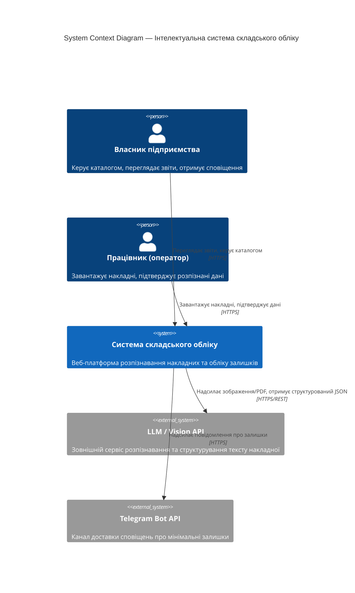
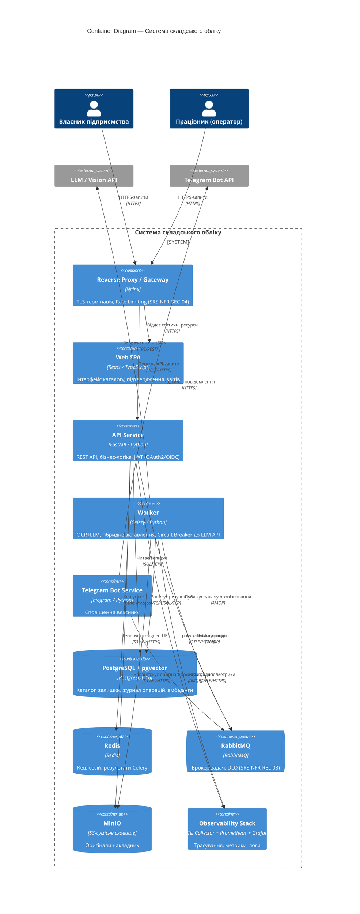

# Розділ 2. Проєктування архітектури системи

## 2.1. Контекстне та контейнерне моделювання системи (C4 Model)

### C4 Level 1 — System Context Diagram

### C4 Level 2 — Container Diagram

**Трасування вимог в архітектуру (Container):**

- Контейнер `Reverse Proxy / Gateway` [C4 Container](#c4-level-2--container-diagram) реалізує нефункціональну вимогу безпеки [SRS-NFR-SEC-04](./srs.md#srs-nfr-sec-04) (Rate Limiting) та базується на рішенні щодо термінації TLS на вхідному шарі.
- Контейнер `API Service` [C4 Container](#c4-level-2--container-diagram) реалізує функціональні вимоги [SRS-FUN-01](./srs.md#srs-fun-01), [SRS-FUN-06](./srs.md#srs-fun-06), [SRS-FUN-08](./srs.md#srs-fun-08) та нефункціональні вимоги безпеки [SRS-NFR-SEC-01](./srs.md#srs-nfr-sec-01), [SRS-NFR-SEC-02](./srs.md#srs-nfr-sec-02) щодо JWT-автентифікації та RBAC.
- Контейнер `Worker` реалізує функціональні вимоги [SRS-FUN-02](./srs.md#srs-fun-02), [SRS-FUN-03](./srs.md#srs-fun-03), [SRS-FUN-04](./srs.md#srs-fun-04) та нефункціональну вимогу надійності [SRS-NFR-REL-02](./srs.md#srs-nfr-rel-02) (Circuit Breaker), а також базується на рішенні [ADR-001](./adr/0001-choice-of-technology.md) щодо зберігання векторних ембедінгів у `PostgreSQL + pgvector`.
- Контейнер `Telegram Bot Service` реалізує функціональну вимогу [SRS-FUN-07](./srs.md#srs-fun-07).
- Контейнер `RabbitMQ` реалізує нефункціональну вимогу надійності [SRS-NFR-REL-03](./srs.md#srs-nfr-rel-03) (Dead Letter Queue) та масштабованості [SRS-NFR-SCALE-01](./srs.md#srs-nfr-scale-01).
- Контейнер `Observability Stack` підтримує моніторинг виконання нефункціональних вимог продуктивності [SRS-NFR-PERF-01](./srs.md#srs-nfr-perf-01), [SRS-NFR-PERF-02](./srs.md#srs-nfr-perf-02).

## 2.2. Компонентне моделювання критичного сервісу (Worker)

```mermaid
C4Component
title Component Diagram — Worker Service (розпізнавання накладних)

Container_Boundary(worker, "Worker Service") {
  Component(consumer, "Task Consumer", "Celery Task", "Приймає задачу розпізнавання з RabbitMQ")
  Component(guard, "TaskSignatureGuard", "Middleware", "Перевіряє HMAC-підпис вхідного повідомлення")
  Component(validator, "TaskValidationMiddleware", "Middleware/DTO", "Валідує схему payload задачі")
  Component(errorHandler, "GlobalErrorHandler", "Middleware", "Перехоплює винятки, формує DLQ-повідомлення")
  Component(orchestrator, "RecognitionOrchestrator", "Python Service", "Координує конвеєр обробки накладної")
  Component(visionPort, "IVisionRecognitionPort", "Interface", "Абстракція розпізнавання (Strategy)")
  Component(matchingRepoPort, "IMatchingRepository", "Interface", "Абстракція доступу до каталогу")
  Component(invoiceRepoPort, "IInvoiceRepository", "Interface", "Абстракція запису результатів")
  Component(matching, "HybridMatchingService", "Python Service", "pg_trgm + pgvector, ранжування кандидатів")
  Component(circuitBreaker, "CircuitBreakerAdapter", "Middleware", "Circuit Breaker + Retry")
  Component(llmClient, "LLMVisionApiClient", "HTTP Client", "Реалізація IVisionRecognitionPort")
  Component(invoiceRepo, "PostgresInvoiceRepository", "SQLAlchemy", "Реалізація IInvoiceRepository")
  Component(catalogRepo, "PostgresCatalogRepository", "SQLAlchemy", "Реалізація IMatchingRepository")
  Component(s3Client, "S3FileClient", "boto3", "Завантаження оригіналу з MinIO")
  Component(publisher, "EventPublisher", "Pika/AMQP", "Публікує подію завершення")
  Component(tracer, "TracingInterceptor", "OpenTelemetry SDK", "Наскрізне трасування")
}

ContainerDb_Ext(db, "PostgreSQL + pgvector")
ContainerDb_Ext(s3, "MinIO")
ContainerQueue_Ext(mq, "RabbitMQ")
System_Ext(llm, "LLM / Vision API")
Container_Ext(obs, "Observability Stack")

Rel(consumer, guard, "Перевірка підпису", "in-process")
Rel(guard, validator, "Валідація схеми", "in-process")
Rel(validator, orchestrator, "Передає задачу", "in-process")
Rel(orchestrator, errorHandler, "Перехоплення винятків", "in-process")
Rel(errorHandler, mq, "Форвардить у DLQ", "AMQP")
Rel(orchestrator, s3Client, "Отримує файл", "in-process")
Rel(s3Client, s3, "Завантажує об'єкт", "S3 API/HTTPS")
Rel(orchestrator, visionPort, "Запитує розпізнавання", "interface call")
Rel(circuitBreaker, visionPort, "Реалізує", "implements")
Rel(llmClient, circuitBreaker, "Обгорнутий", "wraps")
Rel(circuitBreaker, llm, "Надсилає зображення", "HTTPS/REST")
Rel(orchestrator, matching, "Запитує зіставлення", "in-process")
Rel(matching, matchingRepoPort, "Шукає кандидатів", "interface call")
Rel(catalogRepo, matchingRepoPort, "Реалізує", "implements")
Rel(catalogRepo, db, "SELECT з pgvector", "SQL/TCP")
Rel(orchestrator, invoiceRepoPort, "Зберігає результат", "interface call")
Rel(invoiceRepo, invoiceRepoPort, "Реалізує", "implements")
Rel(invoiceRepo, db, "INSERT/UPDATE", "SQL/TCP")
Rel(orchestrator, publisher, "Публікує подію", "in-process")
Rel(publisher, mq, "Публікує повідомлення", "AMQP")
Rel(orchestrator, tracer, "Інструментує виклики", "in-process")
Rel(tracer, obs, "Надсилає спани/метрики", "OTLP/HTTPS")
```

**Трасування вимог в архітектуру (Component):**

- `CircuitBreakerAdapter` реалізує [SRS-NFR-REL-02](./srs.md#srs-nfr-rel-02) та базується на рішенні [ADR-001](./adr/0001-choice-of-technology.md) щодо незалежності доменного ядра від конкретного провайдера розпізнавання (Dependency Inversion).
- `GlobalErrorHandler` реалізує [SRS-NFR-REL-03](./srs.md#srs-nfr-rel-03) (форвард необроблених задач у DLQ).
- `HybridMatchingService` + `PostgresCatalogRepository` реалізують [SRS-FUN-04](./srs.md#srs-fun-04) на основі рішення [ADR-001](./adr/0001-choice-of-technology.md) (pgvector замість виділеної векторної БД).
- `TracingInterceptor` підтримує моніторинг [SRS-NFR-PERF-01](./srs.md#srs-nfr-perf-01), [SRS-NFR-PERF-02](./srs.md#srs-nfr-perf-02).

## 2.3. Документування архітектурних рішень (ADR)

- [ADR-001: Вибір сховища для векторних ембедінгів найменувань товарів](./adr/0001-choice-of-technology.md) — **Approved**.
